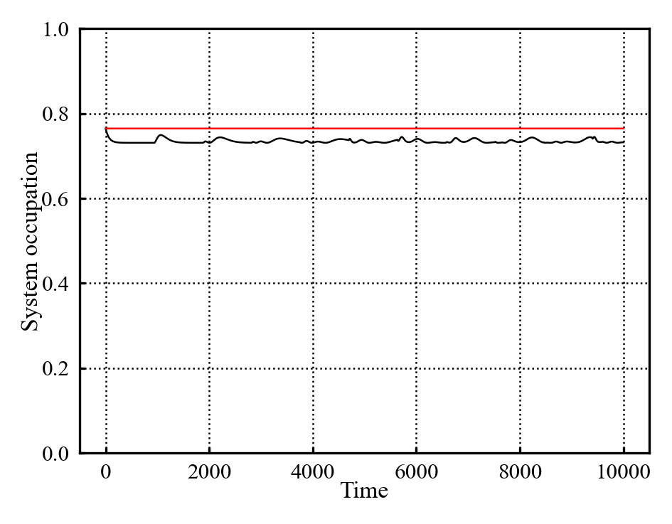

## 14/10/2026

Supervisor meeting:

* Dynamical map vs simulation plot atop on ech other to confirm

* potential stretch goals:
	* different spectral function
	* 2 site impurity potentially
	

* TTM - plotting error more specifically
* TTM - discretization error is less important than thought - TT is exact for its timestep which is what we're interestint

* avoid non thermalizing bound states as a general rule (may be interesting as stretch goal)
* wierdness for system energy near bounds of bath - non thermalization

* presentation:
	* need to convey why is this question interesting
	* don't need to overdo it; can keep it fairly conceptual

* try evolution which starts at thermalization - it may do some wierd stuff

* recent paper which bites out semi circle - spectral function relation to memory; correlations in the bath - acquire later

To do:

* dynamical propagation vs simulation propagation plot - subtract em from each other to show they equal
* Consider plotting simulation evolution that starts at thermalization occupancy
* attempt TTM implementation - don't worry if it takes longer; switch to presentation otherwise
	* If it works quickly, plot it over a basic testing range of parameters
* Draft presentation:
	* Setup slides
	* use slides to figure out what additional plots i'd like to generate for illustrative purposes

## 17/10/2026
Going to start on the presentation today.
Copy/pasting the things i need to include:

* Field background - memory effects in quantum thermodynamic systems
* Project impetus - unclear and somewhat contradicting memory definitions for quantum non markovianity vs classical non markovianity
* Project setup - simulation of star geometry system in order to produce dynamical maps which can be used to test different memory definitions
* Work done thus far
* Preliminary results 
* Future plans

Setting up slides as:

1. Title slide
2. Field background
	* Quantum thermodynamics as a concept​
	* Compare to classical thermodynamics – recap concepts of system, bath, thermalization​
	* Introduce classical ideas of memory effects/markovianity​
3. Project motivation and background
	* State that memory effects in quantum systems aren't fully understood
	* This project aims to compare different definitions of non markovianity by numerical simulation
	* Name drop three definitions
	* This is being done in order to provide additional research context to this area
4. Project setup (model explanation)
	* introduce computational model:
		* 1 dot system connected to a discreetized bath
		* Note this discreetized bath is different to classical case where bath is assumed homogeneous
		* Note spectral function as characterizing bath shape (plot may be useful here)
	* maybe show hamiltonian?
5. Work done thus far part 1:
	* Build up simulation utility - use this as opportunity to explain how the simulation is being propagated through time
	* Show initial simulation test data here (gif of bath/system occupation evolution may help show what this evolution looks like)
	* maybe run an additional sim where the system starts at thermalization - show plot w/occupation start 0, 1, n_{thermal} all in one plot - use this to highlight the wierdness of quantum memory effects
6. Work done thus far part 2:
	* Build up dynamic map extraction - explain dynamic map is "reduced" object which contains full dynamical information
	* Show the simulation vs dynamic map evolution to show that this does indeed perfectly encapsulate the dynamics of the system
	* State that this object is what will be analysed to extract memory definitions
7. Future plans:
	* Implement memory definitions:
		* immediate next step: implement memory kernel definition as "pathfinding" def for formalism
		* examine it's data to gain familiarity w/memory
	* Implement other memory definitions using the insight gained
	* test the definitions against each other with the spectral function as the main "experimental nob"
8. Bibliography

Given that, have quickly tested the initially thermalized occupation setup, and it is indeed odd:

{#fig-thermalInitialOcc} 

Which is what was expected; good to see that it behaves interstingly.

Also looking to generate gif versions of some of the plots for presentation reasons using [@pltGifs], [@pltAnimationHelp].
Have fiddled a bunch and produced the following:



which quarto doesn't seem to be rendering... tmr problem.

## 18/10/2026
Fiddled a bit more w/animation plotting to give better control over animation length yielding:

{#fig-animatedGif} 
