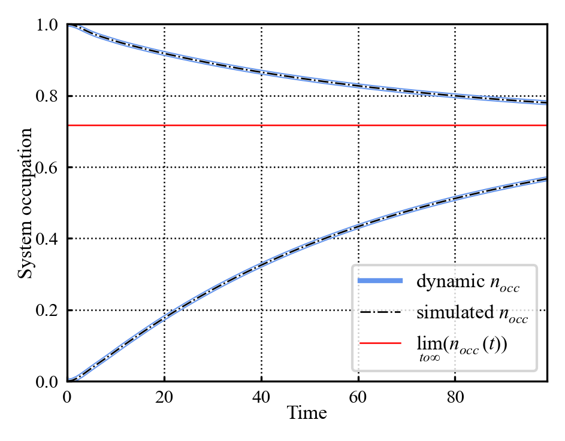
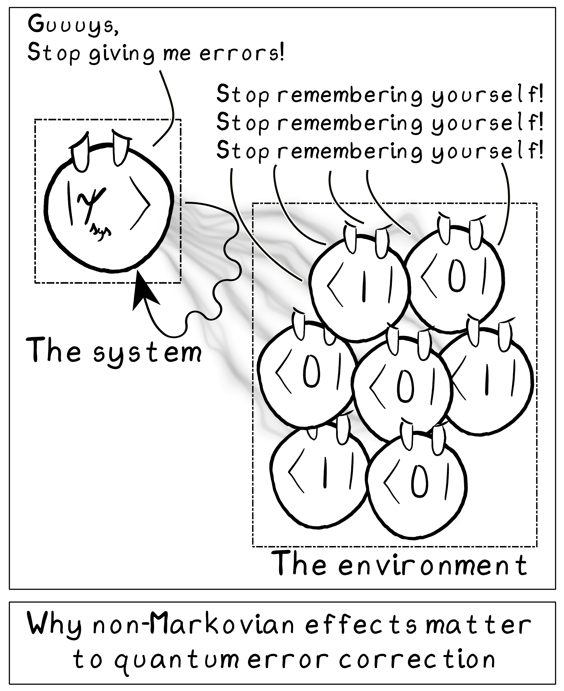

## 26/10/2026
Considering redoing presentation using current draft as a guide. That may help redo some formatting and such whilst being quicker than a full restart.

::: {.column-margin}
Coding sidenote - currently the plotting code is a mess of using the standard params dict and args; i've implemented a quick "copyDict" function which can quickly copy and edit dictionaries in 1 line. I should asp refactor some of the code so that plotting always uses the figparams for everything; and i simply quickly edit the figparams dict using this copyDict function.

May need to think about this further; i could restructure that standardFigParams dict a bit (I.E include list of standard colors, list of labels... then i can do all my plotting through one dictionary instead of arbitrary parameters), however not a now problem; presentation comes first.
:::

First taking a sec to make sure my plotted figs are in their final form.
Have tried Francesco's suggestion for the dynamic map vs simulation plot clarity issue, it helps a lot:

{#fig-newDynamicPlot}

::: {.column-margin}
Coding sidenote - currently have the main simulation utility and a simulation queue. However the simulation queue also has assorted utilities for the purposes of running/saving simulation runs. This may be worth splitting off into it's own little utility as well; so the structure goes "main simulation classes" <-> "simulation handling utilities" <-> "top level simulation queue".

Again not a now thing, but to be considered
:::

Am currently trying to get an animated system occupation over parameter variation animation working; if i can show a parameter variation (I.E coupling strength) which produces memory effects; that'd be cool for presentation reasons.

::: {.column-margin}
A good analogy to verbally use in the presentation is a cup of tea cooling down to room temperature; this immediately connects the idea of open systems to familiar thermodynamics and makes "overshooting" memory driven thermalizations a lot wierder
:::

::: {.column-margin}
Note to self; it may be worth switching the quarto notebook to a book format asp; it would let me have a single export to pdf button for the whole thing, and i suspect that it MIGHT help with displaying mp4 content (had a look at the quarto files for the CDM course (which has mp4 files displayed); thats the only difference i can see assuming there's not some metadata difference internal to mp4s)
:::

Have got something animated that works well enough for now; turning attention back to presentation.

Have reworked presentation completely in power point here [reworked presentation](https://uob-my.sharepoint.com/:p:/g/personal/hx21918_bristol_ac_uk/IQBiDPEAs_J-S6p_8MhuUuLmAYHjqEYJtmfswm4x341tmOk?e=GJUEL3) despite issues w/latex equations. Handled that by copy/pasting latex eqs as pngs from tex editor.

At this point, all the content is in the presentation, what needs doing follows:

* Figure captions
* Citations
* Stock photo for slide 2/8?
* slide transitions

In no particular order; going to put citations in first. Examining the slides, the citations needed follow:

* [@OpenQuantumSystemsIntro2012] - general theory
* [@OpenQuantumSystemsTextbook2007] - general theory
* [@QuantumStochasticProcesses2021] - general theory inc classical analogies and practical applications of the field
* [@EntanglementNonMarkovianity2010] - has theory on dynamic map extraction and general setup stuff
* [@scaryPaper2019] - names the different definitions we're testing
* [@memoryKernelOutline2014] - for memory kernel stuff specifically
* [@MeasureForNonMarkovianity2009] - for backflow stuff specifically
* [@positiveDivisibilityAndMarkovianity2019] for CP divisibility specifically

exporting these to an IOP style produces:

[ ] Rivas Á and Huelga S F 2012 Open Quantum Systems. An Introduction

[ ] Heinz-Peter Breuer, and Francesco Petruccione 2007 The Theory of Open Quantum Systems

[ ] Milz S and Modi K 2021 Quantum Stochastic Processes and Quantum non-Markovian Phenomena | PRX Quantum Online: https://journals.aps.org/prxquantum/abstract/10.1103/PRXQuantum.2.030201

[ ] Reimer V, Wegewijs M R, Nestmann K and Pletyukhov M 2019 Five approaches to exact open-system dynamics: Complete positivity, divisibility and time-dependent observables The Journal of Chemical Physics 151 044101

[ ] Rivas Á, Huelga S F and Plenio M B 2010 Entanglement and non-Markovianity of quantum evolutions Phys. Rev. Lett. 105 050403

[ ] Cerrillo J and Cao J 2014 Non-Markovian Dynamical Maps: Numerical Processing of Open Quantum Trajectories Phys. Rev. Lett. 112 110401

[ ] Breuer H-P, Laine E-M and Piilo J 2009 Measure for the Degree of Non-Markovian Behavior of Quantum Processes in Open Systems Phys. Rev. Lett. 103 210401

[ ] Milz S, Kim M S, Pollock F A and Modi K 2019 Completely Positive Divisibility Does Not Mean Markovianity Phys. Rev. Lett. 123 040401

Right, have put in citations, fig captions, and animation transitions. Some things that still need doing:

* Get stock photo(s)
* figure out how to get video to play on presentation click
* figure out why gifs don't play in presenter mode

Beyond that i'm reasonably happy w/these slides. They're not the most exciting thing in the world; but the information is clear; diagrams and gifs present; citations in. I just need to make sure to get rid of the final "construction" slide (a slide i used to test gifs and such; not part of presentation).

Going to leave it there for now; will likely be back at it after dinner.

## 27/10/2026

###supervisor meeting
Comments on the presentation:

* information backflow squiggly line arrow flip/remove
* project setup - fermi dirac stats - distribution of state - distinction - counts out bath / linked
* dynamic map slide - lambda matrix expression - double check
* memory effect animated plot zoom in y axis
* quotation around memory defs to make em clear - memory defs aren't defined - memory kernels link to dynamic map
* dynamic map - need to state its utility to computing memory defs
* weakness in plan - examine and compare -> regimes where memory definitions disagree "stronger emphasis" - add to motivation slide - figure out why inconsistent - this is the main why
* emphasise fact classical non markovianity is well defined - add to motivation slide 
* motivation slide - can get rid of practical point written - can say verbally
* dynamic map slide - last point - all metrics use dynamic map as main analytical object
* appendix slide for question time (have def, eqs and such)

Other meeting notes:

* unrelated to presentation - bath occupation in coupling strength for memory effect - would be interesting to look at
* next meeting - next steps rather than work

### presentation work:
Summarizing the above points:

* Fig. 1 - information backflow arrow fix [ ]
* Slide 3 - not directly determined to fermi dirac stats - related [x]
* Slide 6 - dynamic map expression - double check [ ]
* Fig. 6 - zoom in y axis [x]
* defining memory defs a bit more - quotation marks around them? def memory kernel expression? [~]
* Slide 2 - state we know there's disagreement between defs - we want to understand why (stronger emphasis) [ ]
* Slide 2 - compare/contrast to fact classical non markovianity is well understood [~] // i think it's best to say this verbally instead of writing it down 
* Slide 6 - Relate dynamic map back to memory defs [x]
* Add appendix slide(s) [x]

In terms of appendicies; these would support Q&A, therefore need to think about what sorts of questions may be asked:

* Details on the memory defs - mainly their eqs
* Details on the hamiltonian and spectral function inc explicit matrix form
* explicit form for initial correlation matrix and details on fermi dirac distribution

Have added all 3; I think that covers most of the specifics i could be asked about.
Have also added a quick note relating dynamic map back to memory defs.
Have adjusted y axis on the memory animation.
Have tweaked fig 5

## 28/10/2026
Have been struggling with finding a stock image for slide 2; so have drawn a gag comic for it instead:

{#fig-gagComic}

Its not exactly professional, but i think it could work on that slide; and hopefully the visual gag will make the presentation a bit more memorable. It does however draw more attention to error correction as an application of this topic; so i would need to anticipate questions on it.

### Potential questions:

Thinking a bit further, the types of questions I can forsee:

* Further details on:
	* The memory definitions (see appendix i)
		* Eqs
		* what they represent:
			* Memory kernel - direct convolutional component to evolution
			* Backflow - measure of information "coming back" to system
			* failure of CP divisiblity - can dynamic maps be composed in terms of each other (~)
		* We suspect that they're will be a hierarchy of defs:
			* there are cases where backflow fails
			* classical CP divisibility is known to be an insufficient condition for classical markovianity
	* The hamiltonian (see appendix ii):
		* operator form of hamiltonian
		* matrix form of hamiltonian
	* Correlation matrix and fermi dirac distribution (see appendix iii)

* How non markovian effects relate to error correction:
	* the textbook [@quantumErrorMemoryContext2013] has some additional info
	* reminder of quantum error correction (citable in textbook; but my understanding from quantum computing course):
		* we consider Qbits experiencing noise as random X, Z operations (all noise can be expressed in these pauli operators)
		* By attaching ancilliary Qbits, can diagnose what type of noise has been applied
		* can map diagnostic "syndromes" directly to correction operations
	* for non-markovian noise; the syndrome and correction operation are not independent; so need additional understanding on the non-markovian evolution to apply correction operations 

* How does non markovian effects relate to other fields:
	* Quantum non-markovianity has important implications for open quantum systems generally - these can be found across many fields
		* condensed matter physics
		* quantum information

* Questions about specific figs:
	* Fig 5 - animated evolution plot
		* Questions about specific parameters (weak coupling, semi-circle $J(\omega)$, bath size)
		* there is harmonic wibbliness in the bath occupation near $\omega=0$ for early t - why? because of small bath size; acts more like harmonic oscillators
	* Fig 7 - general interest; why goes beyond thermalization - information "sloshing" out/back into system - can point out recurrence to highlight memory effect

### general presentation work:

Have done an out loud practice run of the presentation. Was somewhat stuttery/tripping over my words, however thats expected given this is my first proper practice run. Given that caveat, i covered all of the content i wanted to, and did so in 09:45 min; so within the hard 10min time limit. As such i'm confident this presentation covers the right amount of content, and given practice i should be able to present this effectively w/in time.

As such, i'm confident submitting the presentation as it stands; will do a last check over it to make sure i'm happy w/it, but it is otherwise done, and only needs practice.

As such the to do list for the next week till the presentation:

* Double check slides
* Submit slides
* Practice delivering slides
* Consolidate above list of "potential Q&A" into smth i can use as a resource when answering questions

Main other thing to consider, is do i want an appendix slide for the quantum error correction stuff. Its beyond the scope of my project; however is a question i could see being asked, and is smth i'm able to answer.

have adjusted some diagrams for consistency sake.

Have fixed a plot.

I don't think i need a quantum error correction appendix. Whilst i can answer that question, its a tangent from this project, and would be difficult to illustrate concisely using an appendix; i don't think its worth worrying about.

I've done final checks; it looks good, i'm going to download a final copy for safe keeping, and submit it i think.

Have submitted it; can resubmit if i have to, but am happy w/slides. Just need to practice delivery and prep for Q&A.

## 30/10/2026
Spending some time today practicing delivering the presentation.

* First attempt; was waffly and missed a bit; 8:53 min
* Second attempt; was less waffly but managed to overrun to 10:31 min (sidenote; magpie outside my window was an impatient audience)
* Third attempt; less waffly, still overun to 10:18 min
* Fourth attempt; less waffly, within time 09:51 - am worried i'm speaking a bit quickly; i think i can cut down a bit when motivating stuff w/quantum error correction
* Fifth attempt; less waffly; within time 09:25 - i think was a bit slower; i took some more breaks to slow down; cutting the explanation for quantum error correction helped
* sixth attempt - better, 09:25

