## 02/11/2026
Had presentation, think it went decently.
### Quick after presentation scratch notes:

Presentation felt decent,
Went a bit quicker speech wise than i wanted to
Throat scratchy didnt help
Was under time
Questions:
- multiple recurrence, yes, inc side note on small system reccurence
- how quantum error correction, gave practiced answer
- logical qubit size, gave default answer for simple answer, wasnt real logical qbit answer, but i made clear i was talking about minimum example
- real examples of this model, i gave impurity in condesned matter crystal, he one upped w/water molecules

Last 3 were prof, hes a quantum computational guy

Prof was guy who wants to show hes smarter than you, i think i held my own, the power of "this is beyond the scope but..."

I think my minor jokes (i.e big ugly correlation matrix) helped, i saw minor smiles at that

Looking at audience, did better than most i think, but still looked at slides a bit too much

Didnt pause for breath enough i think so went a bit fast

## 04/11/2026

### supervisor meeting
Quickly recapped presentation - went fine, didn't need to cover that too much. Reiterated next steps of implementing metrics, then can examine memory effects. Discussed potential things that can be examined w/memory effects, discussion was a touch rambly/wide ranging but provided useful intuition inc:

* adding narrow peak to spectral function - structure adds memory effects
* relationship between fourrier transform of spectral function and memory effects (system/bath correlations? $\mathcal{F}(J(\omega))\cdot f \approx $ correlations)
* need to seperate effects of structure and overall coupling - need to normalize coupling strength of spectral function 
* discussed some of David's work w/mpemba effect - discussed reentrance time and the gap between initially thermalized state and maximum deviation from that - this may be a useful "mini-memory metric"
* Note - to extract thermalization numerically, can diagonalize $\Lambda \rho_{therm} = \rho_{therm}$, when $\rho_{therm}$ stabilises, is thermalized 
* can map out maximum deviation metric over $\mu$ for $\beta=10$ (see [@DavidMpemba2026] fig 2) - fig 2 phase diagram may be interesting to map out metrics over in general? tbd

immediate plan:

* implement numeric thermalization determination from map
* implement deviation gap mini metric
* implement memory kernel def
* examine metrics over $\mu$ as outlined above

## 07/11/2026
Finally returning to actual work on this project.

### Code work: eigenvector thermalization computation
Going to first try to implement the eigen method for thermalization determination. Unsure exactly how this will work; there are dynamic map matrices for every time step, and given these are $2\times 2$ matrices, i'd assume they have 2 eigenvectors. Going to quickly examine what these look like and see if there's any obvious stabilisation.
This spits out 2 eigenvectors for each timestep of the dynamic map. Comparing $|\vec{v(t_{n})}-\vec{v(t_{n-1})}|$ for the first and second eigenvectors respectively yields:

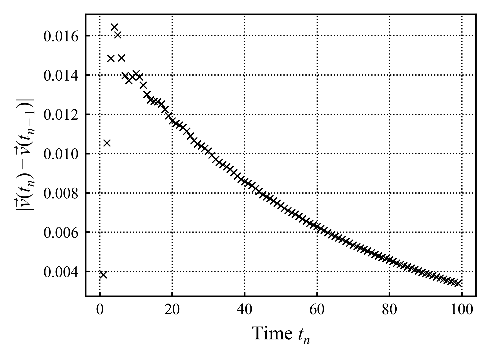{#fig-eigenconvergence1}

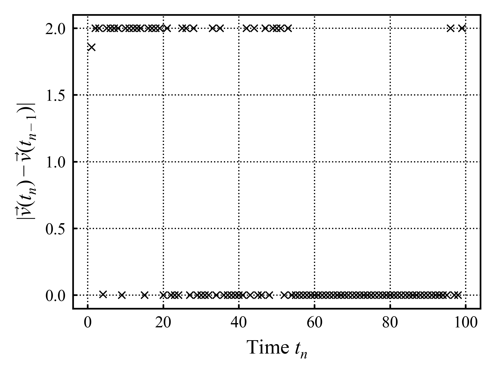{#fig-eigenconvergence2}

hmm, first eigenvector generally converges, second doesn't. The fact @fig-eigenconvergence2 seems to flip between $|\vec{v(t_{n})}-\vec{v(t_{n-1})}|\approx 0, 2$ is suspicious. I could just use the first eigenvector, but I want to make sure this isn't some artefact or smth that could come back to haunt me. The eigenvectors numpy is spitting out aren't normalized, so will start with that; the @fig-eigenconvergence2 flipping may simply be the eigenvector pointing in different directions. Normalization doesn't help too much:

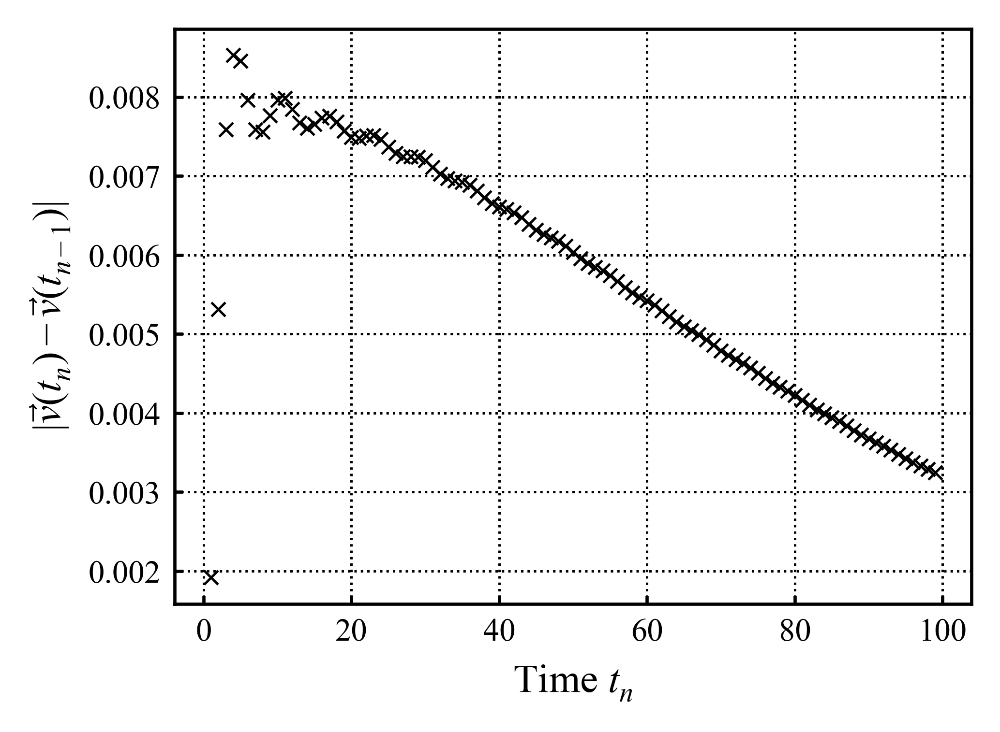{#fig-eigenconvergence1Normed}

{#fig-eigenconvergence2Normed}

Slightly different behaviour but same lack of convergence in @fig-eigenconvergence2Normed. Last thing to try before continuing with the first eigenvector (and validating that against other thermalization measures) is to compare the dot product $\vec{v(t_{n})}\cdot\vec{v(t_{n-1})}$. Ok i may be an idiot. I am definetely an idiot; turns out i've been using np.linalg.eig wrong; so what I thought was the first eigenvector was simply the eigenvalues. Reimplementing stuff with that in mind.
Reexamining @fig-eigenconvergence1 and @fig-eigenconvergence2 with this in mind yields:

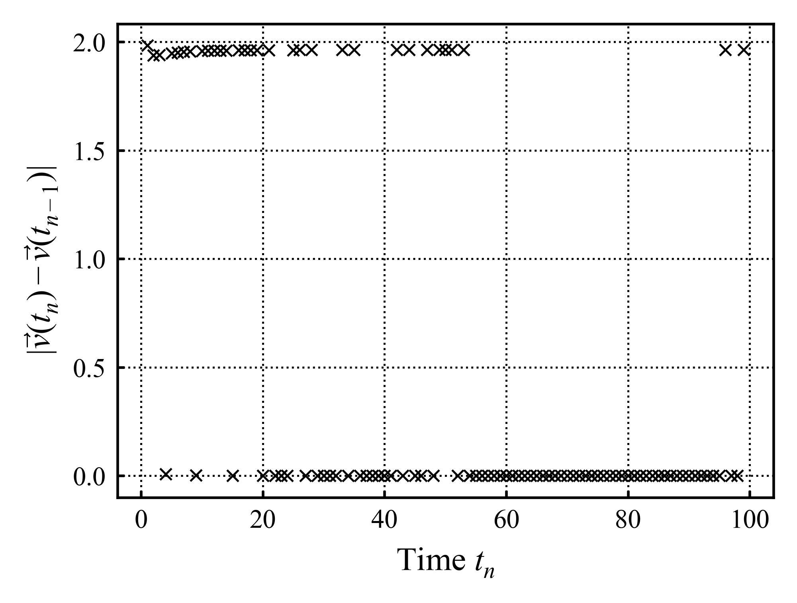{#fig-eigenconvergence1Proper}

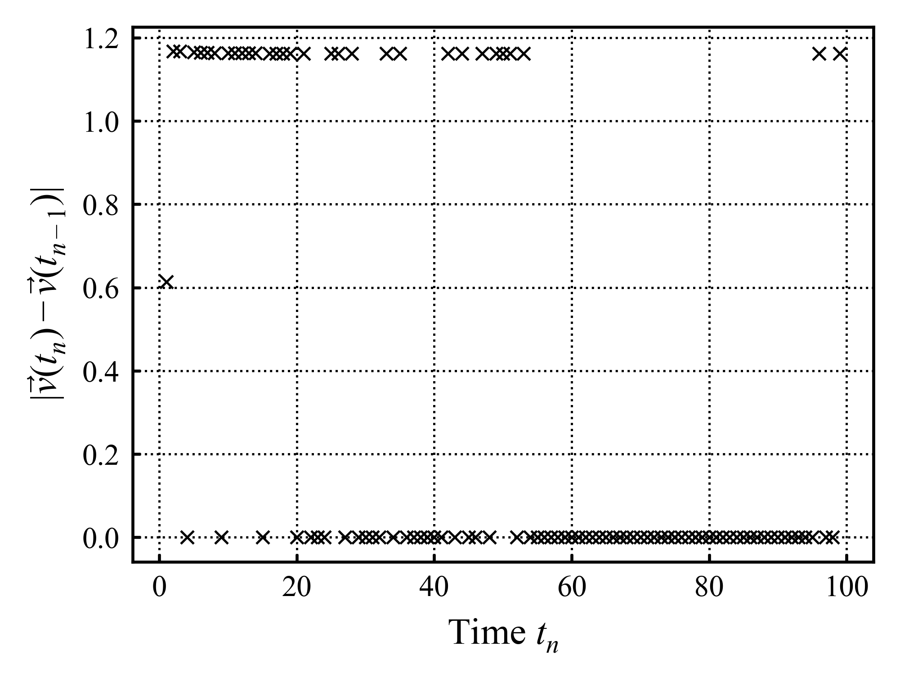{#fig-eigenconvergence2Proper}

Which has the same non convergence as before. I have a suspicion. 

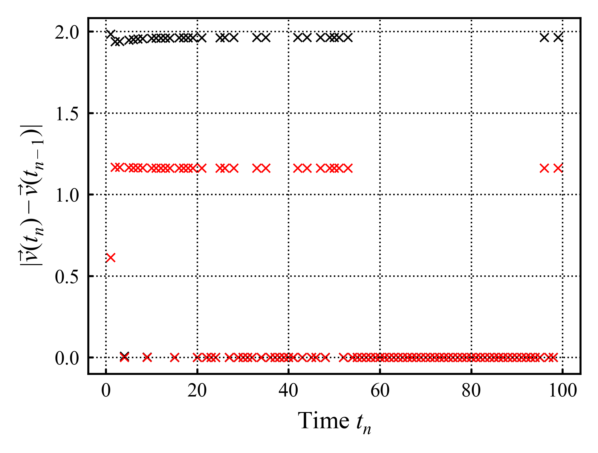{#fig-eigenconvergenceBoth}

Examining @fig-eigenconvergenceBoth, both the first and second eigenvectors seem to stop converging for the same timesteps. I wonder if np.linalg.eig is effectively flipping the first and second eigenvectors at random?

I made another code mistake and wasn't pulling the correct eigenvalues...

The first eigenvector isn't stable, the second does converge eventually. It is not a guarantee that the order of "first unstable, second stable" will generalize; so need to algorithmically decide which is stable, then pick the most stable value. This can be done by simply summing up all the $|\vec{v(t_{n})}-\vec{v(t_{n-1})}|$ values; the one with the lowest sum is more stable so more likely to converge. Then just need to find the time for which $|\vec{v(t_{n})}-\vec{v(t_{n-1})}|$ is minimised, and pick that as the "thermalized" eigenvector.
Have extracted this, hmmmmmmmm. This is an unphysical result. It is giving $\begin{bmatrix}0.13530145+2.42581405\cdot10^{-17}i \\ 0.99080448+0i \end{bmatrix}\approx\begin{bmatrix}0.13 \\ 0.99\end{bmatrix}$. Given that state vectors are of form $\begin{bmatrix}1-p \\ p\end{bmatrix}$ w/$p=$ occupation probability, this isn't a physical result...

I wonder if its a problem due to the relatively short test run times used? Nope running it longer doesn't fix it. Running it w/smaller timestep in case that is the issue. This has no effect.

I may need to rethink how i'm implementing this. Currently i'm just finding the eigenvectors for the dynamic map for all times, seeing how they converge, and picking the best behaved one. I am not applying physicality constraints. A brute force approach where $\begin{bmatrix}1-p \\ p\end{bmatrix}$ is guessed/checked for a range $p$ may be better?

if so, can check dynamic map convergence instead of eigenvector convergence; then brute force check for the physical vector closest to the eigenvector. A binary search for a certain number of steps may be best? Ok this just works right out of the gate.

Right, that was a side step, but that'll be a useful utility in the future.

### First metrics
In terms of memory metrics, my instinct is to attach them to the dynamic map "dualSimulation" class. The main metrics are all expressed in terms of the dynamic map. The main exception is the "mini metric" of "maximum deviation" from the starting occupation; this "mini metric" depends on the specific simulated path.

That said however, I could implement it into the dualSimulation object with an initial occupation parameter.
I think i'll do it like that; its a bit crude but should be fine. A thing worth keeping in mind is the difference between an apparently more non-markovian dip beyond thermalization and thermalization. As such, it's probably worth using the presence of a relative extrema to distinguish between a non-markovian dip and thermalization.

Ok, encountering weird effects. For context the "standard example" of this maximum deviation follows in @fig-maxDevFromAbove whereby $n_{sys}$ starts on one side of thermalization, dips past it before thermalizing properly.

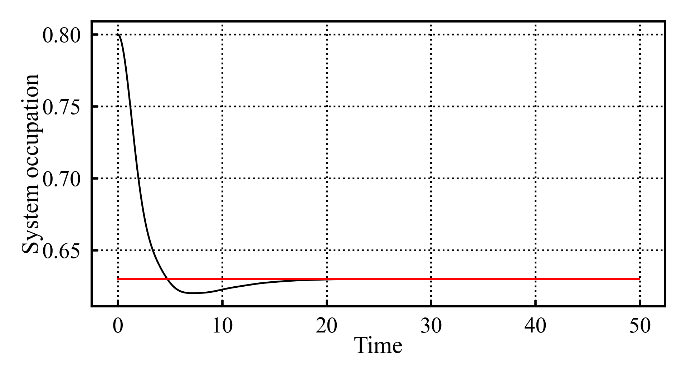{#fig-maxDevFromAbove}

In this context, the "maximum deviation" is the gap between initial occupation and that particular hump.
However trying to reproduce this effect from below yielded:

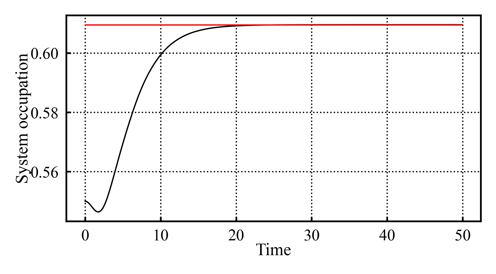{#fig-maxDevFromBelow}

Which moves away from thermalization first before thermalizing normally.
My naive instinct was that it should be possible to symetrically flip @fig-maxDevFromAbove, however that doesn't seem to be the case... This brings some degree of ambiguity in terms of what this "max deviation mini metric" is meant to be measuring. 
Going to take some time to examine these effects for various initial occupations, because i wonder if these "bumps" are being drawn to similar values regardless of where the occupation starts.

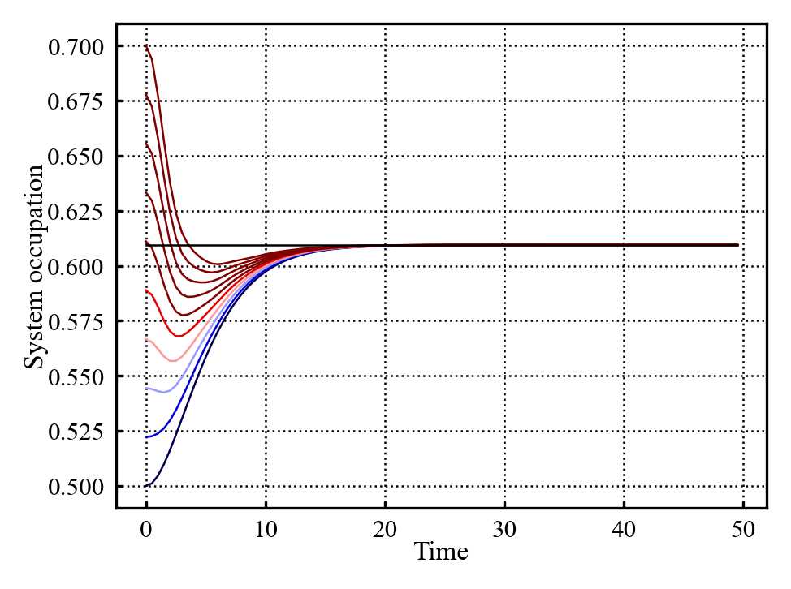{#fig-humpDualSimulation_rangeInitial}

Plotting for a range of initial occupations yields @fig-humpDualSimulation_rangeInitial which does lend the idea that the "bumps" are being drawn to some curve credence...

I'm unsure why this is, however it does expand the initial idea of bumps past thermalization being what needs measuring. In some way this max deviation represents some deviation from a "bumpless" evolution. Unfortunately it doesn't seem simple to substract "w/out bumps" data from "w/ bumps" data in order to try to isolate the "bump" signal. For instance changing the prefactor will necessarily change the timescale of the dynamics requiring rescaling if i'd want to compare them directly.

All that said, i think for this "mini metric" simply doing the deviation from a relative extrema regardless of the shape should be fine?

Have quickly implented a default "examine maximum deviation from initially thermalized state" utility and plotted it as:

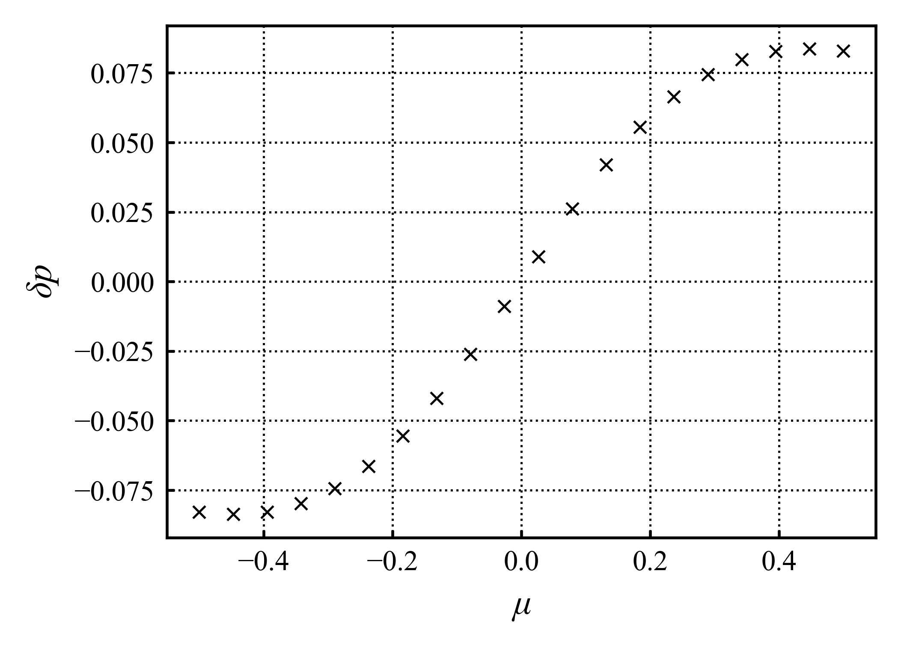{#fig-maxDevOverMu}

Interesting how well behaved it is. I wonder if i decrease the temperature if it will show a sharper curve?

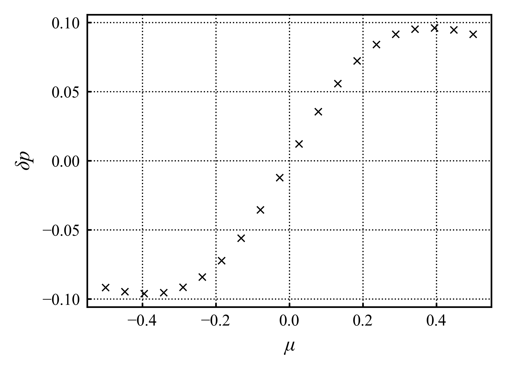{#fig-maxDevOverMuBeta1-}

Well thats interesting... its not a logistic function; but I doubt its periodic... Actually, examining [@DavidMpemba2026] fig 2 this is consistent. It seems to be generally of the right order of magnitude and behaviour at first inspection. And that is enough for today, will get back to this another time.

## 08/11/2026
Think i'm going to do some minor code restructuring/cleanup today.
Main thing is that i want the "code utilities" that standardise simulation and data calls to be a bit cleaner. Particularly i currently do not make use of the save/load utilities. Given that compute times are increasing, being able to load in standard simulation sets for analysis will likely be useful.

an additional related bit of work is restructuring how i'm organising my saved data. Currently its all in a disorganised folder. I think most of whats currently there can be moved to a "pathfinding" data folder, and a better organisational structure can then be implemented for the long term.

Have implemented and tested some loading utilities.
Currently the utilities also have some functions which can easily generate and simulate parameter variations for a single parameter. This is fine currently, but I do want the option of varying multiple parameters over a $d>1$ parameter space. As such I want to rethink exactly how i'm storing these "datasets" for multiple runs.

Currently with 1D variations (1 parameter is varied) a list of parameter args and a list of simulations or dualSim objects is sufficient. However if I end up making multidimensional parameter spaces, that approach may get cumbersome.

It may be worth implementing a "dataset" class which handles this. This would keep track of the coordinates in parameter space and their corresponding simulation/dual simulation. Given that i'll mostly be working with the dynamic map from now on, I think it's mainly worth implementing it for the dualSim object. If i need this functionality for the simulation class, i can implement that later.

This "dataset object" should ideally:

* store points in parameter space - this includes both the parameters and the attached dualSimulation object
	* this will also require constructing/running this space in the first place, i think this construction should follow a "grid" construction - i give it lists of parameter variations (I.E, spectralPrefactor: [0.01, 0.02...], beta: [0, 0.1...]) then it will construct all combinations of points (I.E [[(0.01, 0), (0.01, 0.1)] ... [(0.02, 0), (0.02, 0.1)] ...]) 
* be able to save itself to folder/file
* be able to load itself from folder/file
* handle queries to the data:
	* should be able to request dualSim associated w/specific coordinates in parameter space
	* should be able to request "slices" of the data - specify some fixed parameter and let the rest vary

This will take a bit of time to implement robustly, however it should make the rest of this project a lot easier.
The main question then is how do i want to structure the internal "parameter space" datastructure. It will need to be spat out to a 1D list asp for saving/loading purposes. However it'd be nice to be able to access the data in the full dimensional space.
Pandas may help, pandas dataframe w/each row a different point; columns for all the parameters, one column for the corresponding dualSim object. this would let me access data using pandas filtering functionality.

Have started implementing this, however not finishing today i think.
