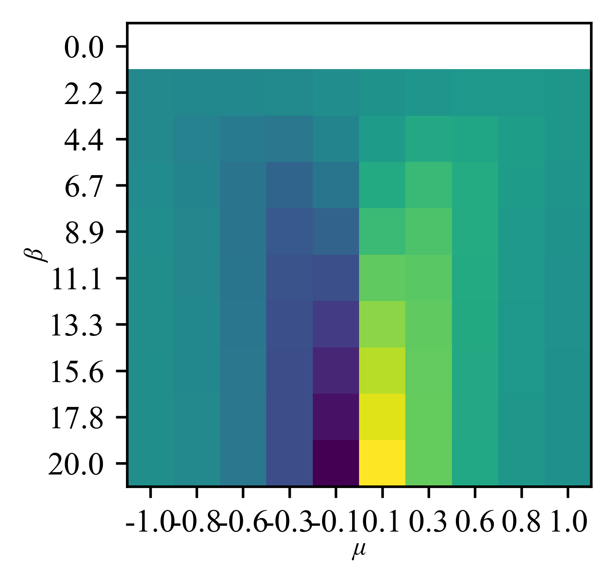
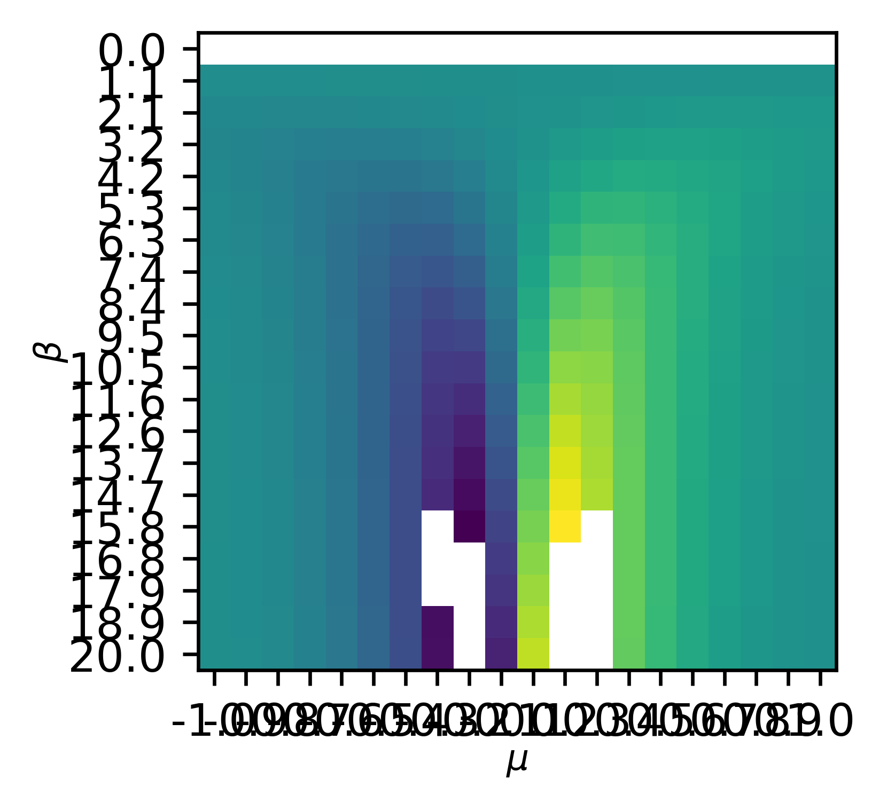

## 10/11/2026
Right continuing refactoring work.
Going to split off the "simulationQueue.py" file into two; "simulationHandlers.py" and "simulationQueue.py".

Have seperated stuff out and finished the basic implementation for the dualDataset object. It is able to be instantiated over a grid, run dual sims for each of those grid points, save itself to a standard format, and load itself from that standard format.

Still need to implement the accessor methods. I think i'd like it to spit out the sliced data as an appropriately shaped "inputArgs" and corresponding array of dualSims (same shape). Therefore if i ask for a 2D slice of the data (I.E, prefactor and bandwidth varied for all other args constant), it should give me a 2D array of prefactors/bandwidth points, and a 2D array of dualSims.

This is effectively the inverse operation of "constructParameterSpace" which takes variations in parameters and produces a 1D representation for a dense grid of args; this needs to take a slice, seperate it out by its variations in order to produce a multidimensional array of args/dualSims.

I suspect i may need a recursive helper method which takes a dict of arg lists (inc a list of indices), then spits out the multidimensional array filled w/row indices.

Right after a little bit of thinking and tinkering, have managed to get the slicer working. it spits out an appropriately shaped array of args, and appropriately shaped array of dualSimulation objects.

A quick test case i could use this for to illustrate its utility is reproducing [@DavidMpemba2026] fig 2 entirely.

Ok i'm glad i've implemented saving/loading functionality; this will save time. Given that even a 2D space w/reasonable sampling could have hundreds of simulated points; being able to load these from memory may speed things up.

ok something else is broken and not working, debugging.
ok have got a patch fix; need to refine these methods, but have it working enough for this specific set of tests. For some reason loading in data is taking forever... Turns out that the analytical thermalization was being recomputed every time; have put a "do not do that" optional param into the system to avoid those issue.

Its a VERY rough figure, but a quick attempt at reproducing that phase diagram yields:

{#fig-muBetaPhase}

This isn't quite the same as [@DavidMpemba2026] fig 2, but some common features emerge. The behaviour about $\mu=0$ is familiar - there is a nearly discontinuous line as the max deviation sign flips. Furthermore for lower $\beta$ (and higher $T$) there is a "smearing" with less extreme values. Two features differ. First of all, @fig-muBetaPhase returns NaN for $\beta=0$. This isn't necessarily an issue, i suspect its just a boundary computational effect which can be ignored for now. More importantly, [@DavidMpemba2026] fig 2 has symetrical "gaps" in max deviation for $\beta>7$ about $\mu$. These aren't present in @fig-muBetaPhase. I suspect the simulation parameters aren't the same; @fig-muBetaPhase was produced using standard test parameters i've been using the validate the code.

Ok quickly skimming [@DavidMpemba2026], they use $f_{pre}=0.02/\pi^2 \approx 0.002$, so is less coupled than $f_{pre}=0.005$. This may explain why @fig-muBetaPhase lacks this region.

Right running another dataset with that prefactor and a finer resolution now that it seems to be working. After much anticipated waiting (~20min), it has produced (a rather ugly plot):

{#fig-muBetaPhase2}

Which not what i expected... I strongly suspect that the gaps in this are computing artefacts. Alternatively, these may be the same gaps as in [@DavidMpemba2026], but incomplete for whatever reason. A thing which may cause issues is the relatively long timestep $\Delta t=1$ - this makes for a rather coarse time evolution which may obscure the actual maximum deviation value.
Additionally, the sims aren't running for particularly long ($t_{max}=50$), therefore the numerical thermalization may not be converging properly, skewing the results.
I'm unsure how this would affect the data... Not a today problem, will discuss this w/supervisors tmr.

## 11/11/2026

### Supervisor meeting
* analytically relate kernel to map - try to gt idea of what it represents
* implement kernel
* reaction coords - expanding system to inc bath sites
* lack of gaps in @fig-muBetaPhase are expected - slightly different measure to in paper

To do list:

* Continue as planned
	* can connect the expression for the map to the kernel directly
	* impleent the kernel method

Some longer term ideas discussed:

* potentially explore the correlations w/bath more explicitly; these are source of memory, so may be useful in later analysis
* maybe expand system to include a bath site - reaction coords - expanding system to inc bath sites - (The reaction coordinate mapping in quantum thermodynamics)