## 17/11/2026
Right, recap; have implemented memory kernel computation, however its a 2x2 matrix; so what its terms represent isn't exactly clear. Tried to analytically relate these terms to more intuitive quantities, however haven't reached an end there.

I think it may be worth going back to the code; and actually plotting some things. Sure its unclear what exactly should be plot; but given its a 2x2 matrix, there's a limited number of things to plot. Plotting all of these may help me understand the analytics at play.

As such, given:

$$
\begin{align}
T_{k} &= \begin{bmatrix} a_{k} & b_{k} \\ c_{k} & d_{k} \end{bmatrix} \\
a_{k}&=1-c_{0}(t_{k})-\sum_{j=1}^{k}a_{j}+c_{0}(t_{k-j})(b_{j}-a_{j}) \\
b_{k}&=1-c_{0}(t_{k})-\sum_{j=1}^{k}a_{j}(1-c_{0}(t_{k-j}))+b_{j}c_{1}(t_{k-j}) \\
c_{k}&=c_{0}(t_{k})-\sum_{j=1}^{k}c_{j}+c_{0}(t_{k-j})(d_{j}-c_{j}) \\
d_{k}&=c_{1}(t_{k})-\sum_{j=1}^{k}c_{j}(1-c_{0}(t_{k-j}))+d_{j}c_{1}(t_{k-j}) \\
\end{align}
$${#eq-tensorMapRelation}

$$
v_{k}=a_{k}+c_{k}=1-\sum_{j=1}^{k}v_{j}(1-c_{0}(t_{k-j}))+w_{j}c_{0}(t_{k-j})
$${#eq-tensorMapSubstitution1_v}

$$
w_{k}=b_{k}+d_{k}=1+c_{1}(t_{k})-c_{0}(t_{k}) - \sum_{j=1}^{k}v_{j}(1-c_{0}(t_{k-j}))+w_{j}c_{1}(t_{k-j})
$${#eq-tensorMapSubstitution1_w}

from last week, there are 6 obvious things to plot; $a,b,c,d$ and $v,w$. It may also be worth defining some norm over the entire $T$ and plotting that as well.

Recalling my quantum computing course notes, an operator norm may be defined as:

$$
||A||=max(A\ket{\psi})=max(\lambda_{i})
$${#eq-operatorNorm}

Where max(\lambda_{i}) is the largest eigenvalue of operator A. Quick search reveals this def to be the "spectral norm" [@spectralNorm]; reading np docs it can be implemented using numpy.linalg.norm, however this is apparently slow according to [@spectralNormStackOverflow]; given hermitian operators (which this should be), so can speed it up.

Ok, have got a basic plot:

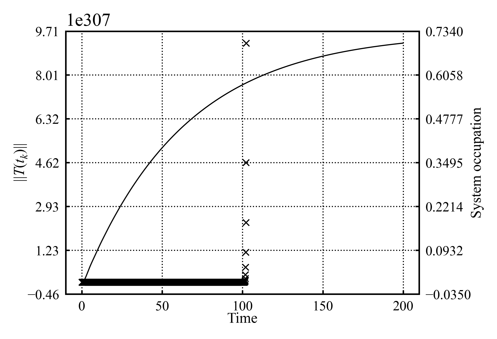{#fig-normedKernelFirstAttempt}

And this leads me to believe i've implemented something wrong. I sincerely doubt that the memory kernel diverges for a well behaved evolution.
I flipped a sign in one of the computations; fixing that provides:

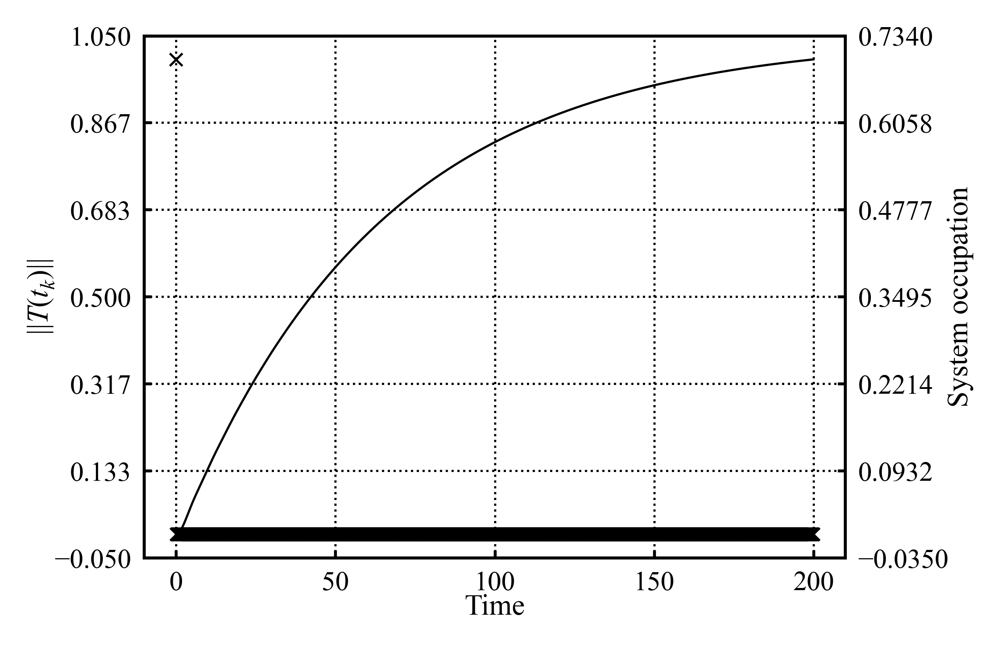{#fig-normedKernelFixedAttempt}

Which seems a lot more reasonable.
Actually not, most of those values (save the first) are 0s...
ok for some reason the summation term in @eq-transferTensorTransform2

$$
T_{k} = \Lambda_{k}-\sum_{j=1}^{k}T_{j}\Lambda_{k-j}
$${#eq-transferTensorTransform2}

is exactly equaling to $\Lambda_{k}$, causing it to cancel out exactly.
Ok was indexing that summation wrong; have fixed...
Odd behaviour, switching from the manual implementation of spectral norm to numpy's built in helps, but still odd behaviour:

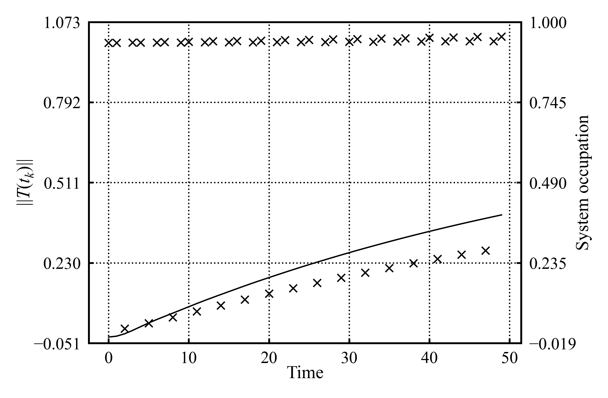{#fig-normedKernelFixedNonMarkovian}.

With some discontinuous jumping between two general trends.
Increasing the timestep produces:

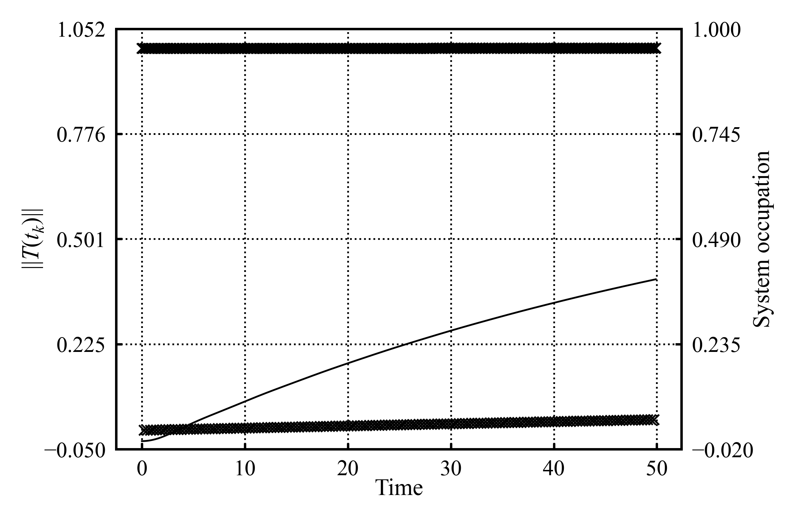{#fig-normedKernelHigherTimeStep}.

Which seems to "converge" these two trends to more constant values. This apparent convergence is expected; as $\delta t\to 0$, the transfer tensor should approach the memory kernel; this is somewhat illustrated by [@analyticalTransferTensor2026] fig 3. Given that @fig-normedKernelHigherTimeStep uses non markovian standard parameters, the kernel should go to 0 which it does for one of the trends, not the other. I wonder if i'm just not using the numpy function correctly...
It seems i am...
Numpy has some other matrix norms; gonna quickly try some of the others...
The "frobenius norm" is similiarly discontinuous:

{#fig-frobeniusNormedKernel}.

As is the "nuclear norm":

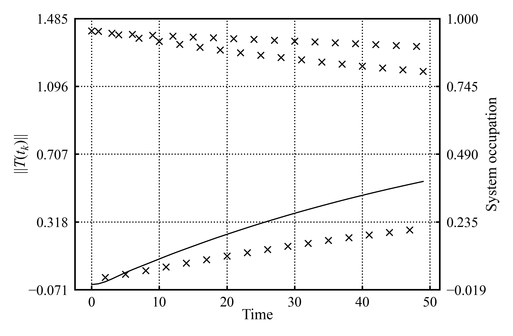{#fig-nuclearNormedKernel}.

hmmmmmmmm...
It may be worth trying to figure out if there is an actual discontinuity in the tensor, or if it's an artefact of the norm.
A first step to doing so would be to plot the components of $T$ and see if there's any obvious discontinuity there.

A bit of a crude plot, however plotting the real components of $T$ yields:

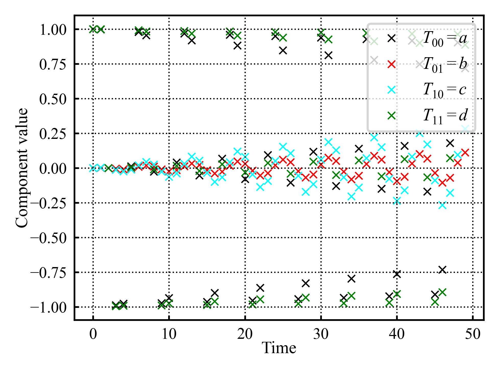{#fig-memoryKernelComponents}.

Which also shows this discontinuity...
This tensor is expressed in terms of the dynamic map, going to check its components as well:

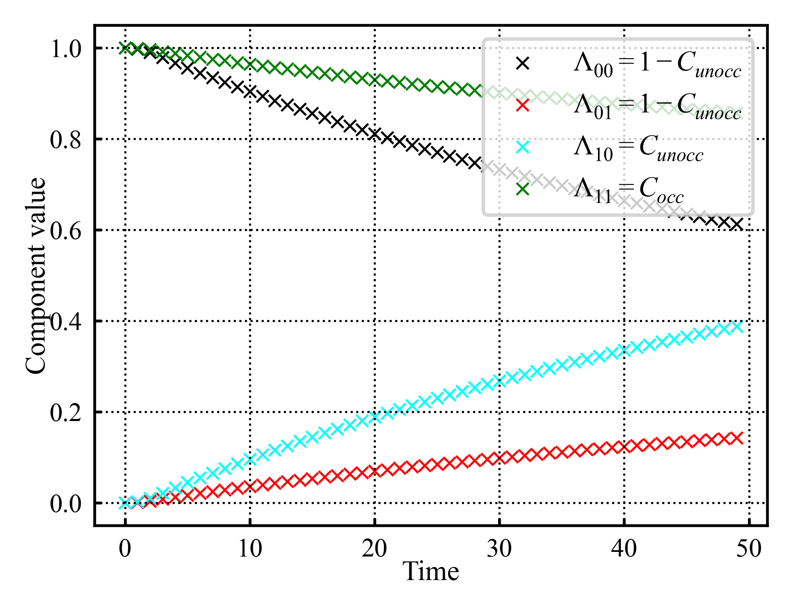{#fig-dynamicMapComponents}.

So the dynamic map is continuous, but the memory kernel may not be... (i say may not because @fig-memoryKernelComponents only shows the real components of each term).

Increasing $\delta t=1 \to 0.5$ doesn't qualitatively change anything:

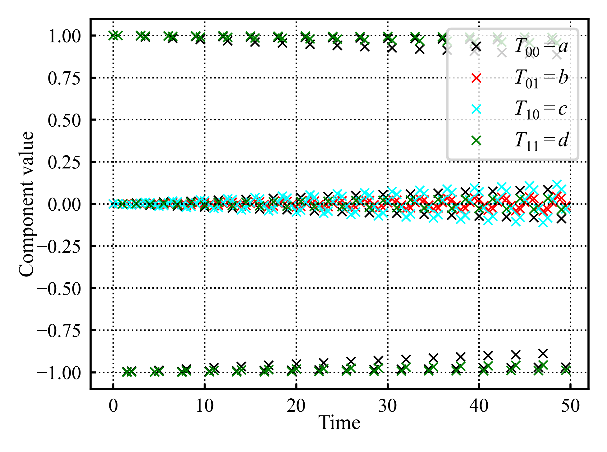{#fig-kernelComponentsDenser}.

Can check continuity of the memory kernel itself by examining $||T_{k}-T_{k-1}||$; going to use spectral norm for this.

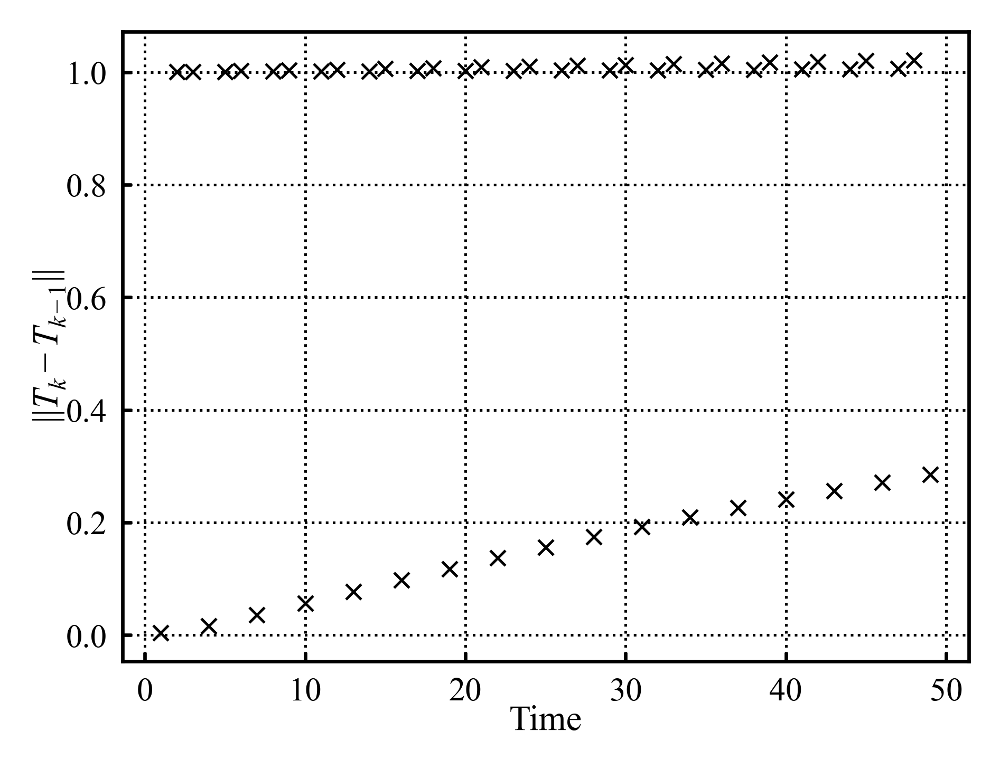{#fig-kernelContinuity}.

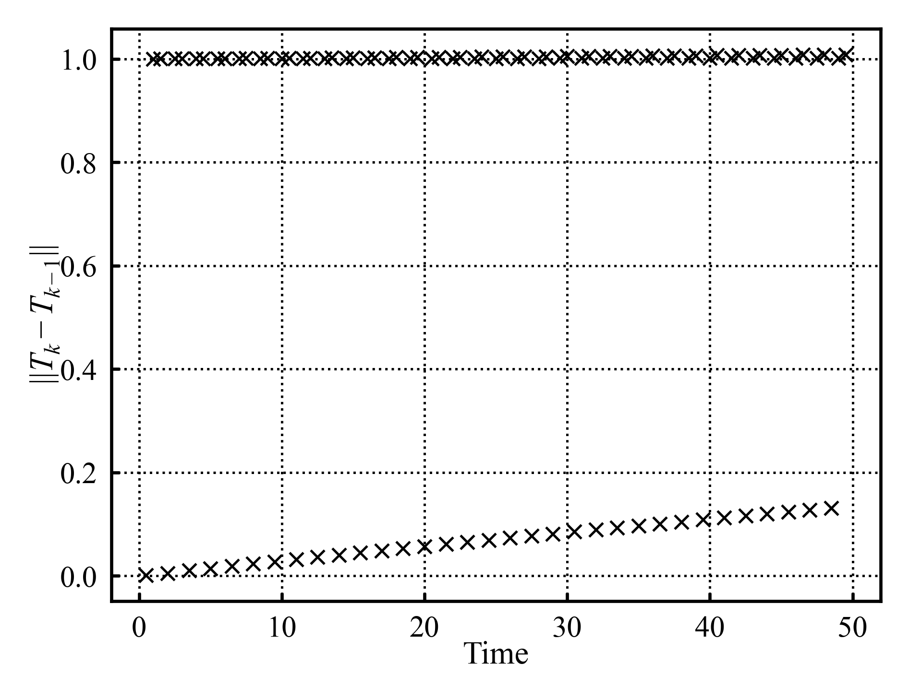{#fig-kernelContinuityDense}.

Its interesting how the norm seems to jump between the "continuous" part and $||T_{k}-T_{k-1}||=1$ for 2 points, then back to the "continuous" part. I wonder if (for some reason) some reflection or rotation transformation is being applied s.t $AT_{k}=V_{k}$, $AAT_{k}=W_{k}$, $AAAT_{k}=T_{k}$, $||T_{k}-V_{k}||=1$, $||V_{k}-W_{k}||=1$...

Copy/pasting the first few memory kernels from the code output yields:

$$
\begin{align}
T_{0} &= \begin{bmatrix} 1 & 0 \\ 0 & 1 \end{bmatrix} \\
T_{1} &= \begin{bmatrix} 0.99724679 & 0.00106782 \\ 0.00275321 & 0.99893218 \end{bmatrix} \approx \begin{bmatrix} 1 & 0 \\ 0 & 1 \end{bmatrix} \\
T_{2} &= \begin{bmatrix} 0 & 0 \\ 0 & 0 \end{bmatrix} \\
T_{3} &= \begin{bmatrix} -0.98694813-3.23111680\cdot 10^{-19}i & -0.00504947+1.04708321\cdot 10^{-21}i \\ -0.01305187+3.23111680\cdot 10^{-19}i & -0.99495053-1.04708321\cdot 10^{-21}i \end{bmatrix} \approx -\begin{bmatrix} 1 & 0 \\ 0 & 1 \end{bmatrix}\\
T_{4} &= \begin{bmatrix} -0.97626925+8.64047521\cdot 10^{-19}i & -0.00913725+6.48035641e\cdot 10^{-19}i \\ -0.02373075-8.64047521\cdot 10^{-19}i & -0.99086275-6.48035641\cdot 10^{-19}i \end{bmatrix} \approx -\begin{bmatrix} 1 & 0 \\ 0 & 1 \end{bmatrix}\\
T_{5} &= \begin{bmatrix} 0.01239272+3.23038288\cdot 10^{-18}i & -0.00464539+1.51129964\cdot 10^{-18}i \\ -0.01239272-3.23038288\cdot 10^{-18}i & 0.00464539-1.51129964\cdot 10^{-18}i \end{bmatrix} \approx \begin{bmatrix} 0 & 0 \\ 0 & 0 \end{bmatrix}\\
T_{6} &= \begin{bmatrix} 0.97976237+1.61664863\cdot 10^{-18}i & 0.00806559+8.73035960\cdot 10^{-19}i \\ 0.02023763-1.61664863\cdot 10^{-18}i & 0.99193441-8.73035960\cdot 10^{-19}i \end{bmatrix} \approx\begin{bmatrix} 1 & 0 \\ 0 & 1 \end{bmatrix}\\
T_{7} &= \begin{bmatrix} 0.956307  -3.70285829\cdot 10^{-18}i & 0.01706489-9.36264110\cdot 10^{-19}i \\ 0.043693  +3.70285829\cdot 10^{-18}i & 0.98293511+9.36264110\cdot 10^{-19}i \end{bmatrix} \approx\begin{bmatrix} 1 & 0 \\ 0 & 1 \end{bmatrix}\\
T_{8} &= \begin{bmatrix} -0.02601805-5.96955427\cdot 10^{-18}i & 0.00995065-3.82443416\cdot 10^{-18}i \\ 0.02601805+5.96955427\cdot 10^{-18}i & -0.00995065+3.82443416\cdot 10^{-18}i \end{bmatrix} \approx\begin{bmatrix} 0 & 0 \\ 0 & 0 \end{bmatrix}\\
\end{align}
$$

Which is interesting. It seems to be almost a $T_{k}=T_{k-1}-T_{k-2}$ behaviour (with some additional wibbliness).
It may have been another indexing problem... 

For context, @eq-transferTensorTransform2 is 1-indexed, the code is 0 indexed. First attempt, summation was running $j\in[0, k]$ which resulted in diverging behaviour, second attempt summation was running $j\in[0, k-1]$ resulting in this discontinuous behaviour; trying $j\in[1, k]$ yields:

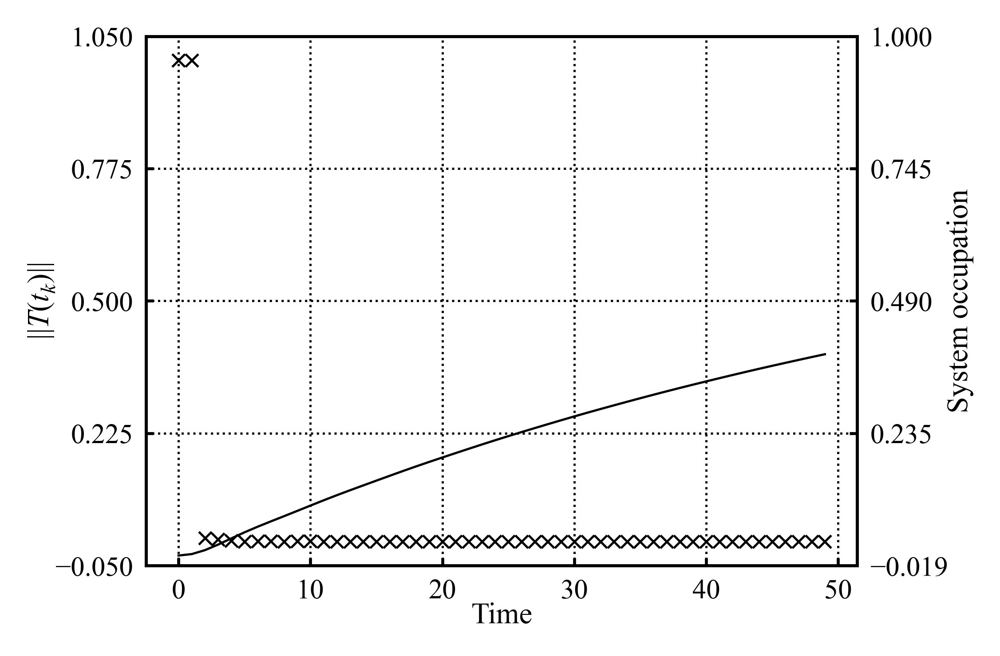{#fig-kernelIndexAttempt}.

which seems reasonable.
Attempting this for a markovian evolution:

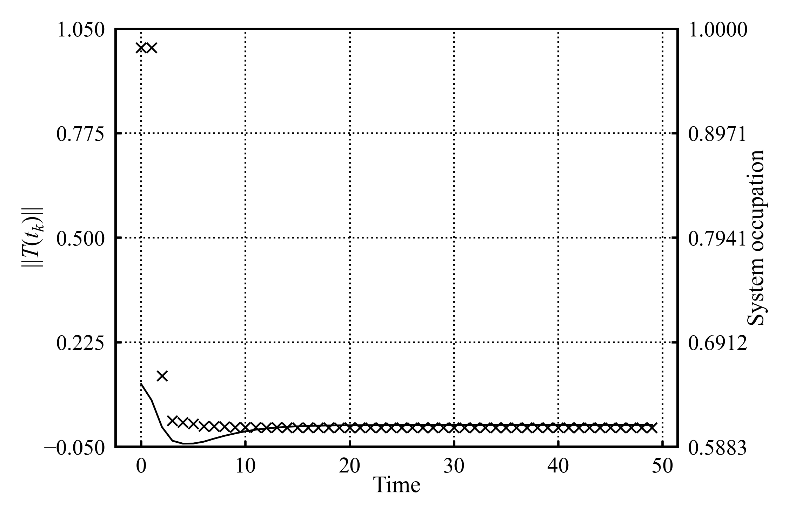{#fig-markovianKernelIndex}.

hmmmm, less reasonable... May curtail the first two memory kernels; see what that produces?

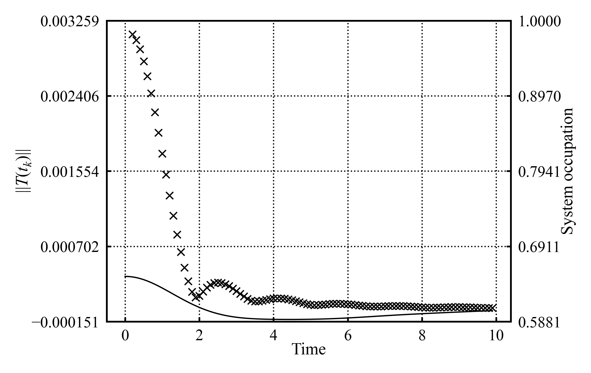{#fig-kernelMarkovianCurtailed}.

now THAT looks more reasonable. Examining the components in a similar manner yields:

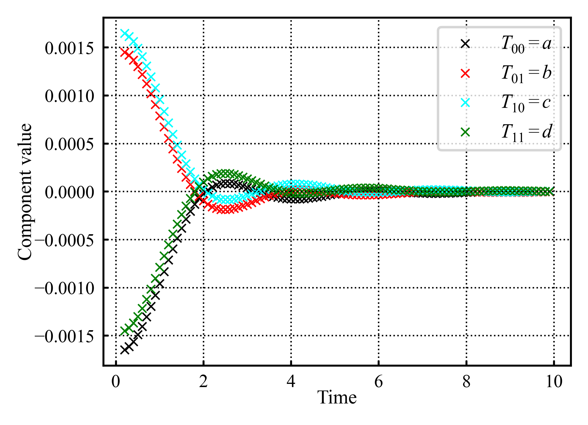{#fig-kernelComponentsFixed}.

Which illustrates a lot of structure. There does appear to be a symmetry between $a,c& and $b,d$; so it seems that $v=a+c$, $w=b+d$ from last week may actually be useful to look at. 

A few things to note:

* the memory kernel doesn't depend on the initial occupation; these plots don't need to show the system evolution necessarily
* it makes sense the first few kernels are nonsense, there's no past evolution to speak of.

Going to put this down for today; have other things i need to do, but progress!

## 19/11/2026

Supervisor meeting went well, general discussion points:

* fit memory kernel to exp decay * sinusoidal
* fourrier transform data - can probably extract periodicity
* propagate system evo w/memeory kernel to compare to dynamic map as sanity check
* check markovian regime
* compare for smaller time steps
* examine first most important bath mode - compare to memory kernel; should be comparable? 
	* chain mapping may help with this - may also help with expanding system later
	* the wierd wibbles of bath evolution!

